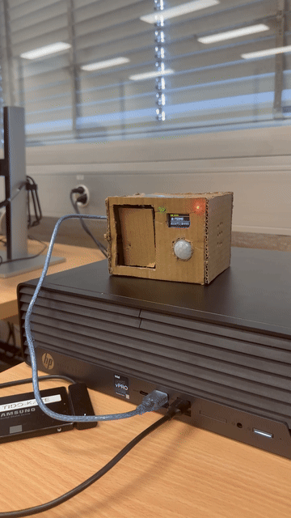
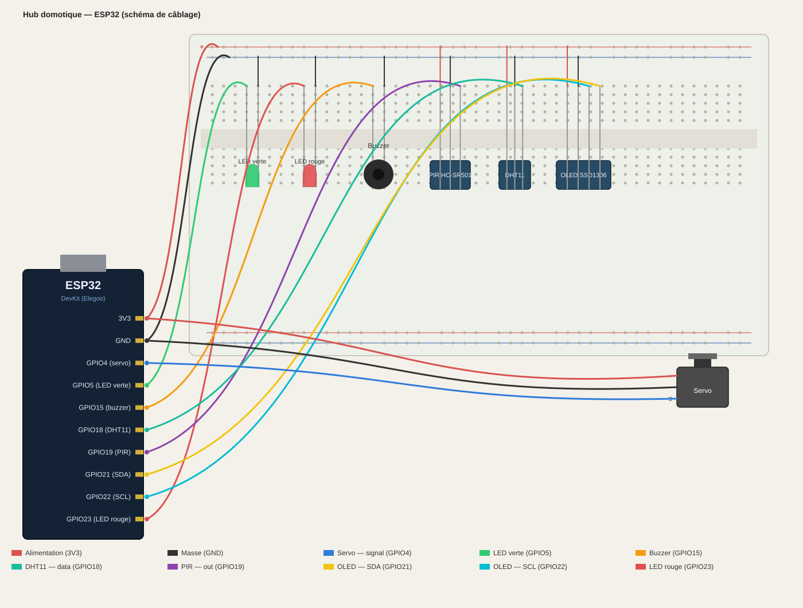

# Hub Domotique — ESP32

Hub de contrôle d'accès à base d'ESP32 : détection de mouvement, ouverture automatique (servo), affichage d'état sur écran OLED, et dashboard web temps réel pour supervision et pilotage à distance. Un agent IA permet aussi d'interroger le hub en langage naturel (voir [Agent IA](#agent-ia)).



## Fonctionnalités

- **Détection de présence** via capteur PIR → ouverture automatique du loquet
- **Verrou motorisé** (servomoteur) piloté à distance ou automatiquement
- **Affichage local** sur écran OLED (état porte, température, humidité)
- **Indicateurs visuels** (LED verte = ouvert, LED rouge = fermé) + signal sonore (buzzer)
- **Mesure température / humidité** en continu (DHT11)
- **Dashboard web embarqué** (serveur HTTP sur l'ESP32) : consultation en temps réel et ouverture manuelle depuis un navigateur, sur le réseau local

## Matériel utilisé

| Composant              | Rôle                          | Broche ESP32 |
|-------------------------|-------------------------------|--------------|
| ESP32 DevKit (Elegoo)   | Microcontrôleur / Wi-Fi       | —            |
| Capteur PIR (HC-SR501)  | Détection de mouvement        | GPIO19       |
| Servomoteur             | Verrouillage / déverrouillage | GPIO4        |
| LED verte               | Indicateur "ouvert"           | GPIO5        |
| LED rouge               | Indicateur "fermé"            | GPIO23       |
| Buzzer                  | Signal sonore                 | GPIO15       |
| DHT11                   | Température / humidité        | GPIO18       |
| Écran OLED SSD1306      | Affichage local (I2C)         | SDA 21 / SCL 22 |

## Schéma de câblage



## Dashboard web

Une fois connecté au Wi-Fi, l'ESP32 héberge une page web accessible depuis n'importe quel appareil du réseau local (`http://<IP_DE_L_ESP32>/`), affichant :

- l'état de la porte (ouverte / fermée) en temps réel
- la température et l'humidité actuelles
- un bouton pour déclencher l'ouverture manuellement

## Installation

1. Cloner ce dépôt
2. Ouvrir le projet dans l'IDE Arduino (ou PlatformIO)
3. Installer les bibliothèques nécessaires :
   - `Adafruit SSD1306`
   - `Adafruit GFX`
   - `ESP32Servo`
   - `DHT sensor library`
4. Renseigner votre SSID et mot de passe Wi-Fi dans `HubDomotique/HubDomotique.ino` (variables `ssid` et `password`) — ne jamais committer vos vrais identifiants
5. Câbler les composants selon le schéma ci-dessus
6. Compiler et téléverser sur l'ESP32
7. Récupérer l'adresse IP affichée dans le moniteur série et l'ouvrir dans un navigateur

## Fonctionnement

0. Au démarrage, prévoir environ **1 minute de stabilisation du PIR** : le capteur déclenche des faux positifs tant qu'il n'est pas calibré, ignorer les premières détections
1. Le PIR détecte un mouvement → la porte s'ouvre automatiquement (servo), la LED verte s'allume, le buzzer bipe, l'écran OLED affiche "OUVERT"
2. Après quelques secondes, la porte se referme automatiquement (LED rouge, écran mis à jour)
3. La température et l'humidité sont relevées en continu et affichées sur l'OLED et le dashboard
4. Une ouverture manuelle est possible à tout moment depuis le dashboard web

## Agent IA

Un agent en Python qui répond à des questions en langage naturel (« Il fait combien dans la pièce ? ») en interrogeant le hub par HTTP. Le projet sert à apprendre comment on connecte un LLM à un système réel : outils, gestion des erreurs, garde-fous.

Le code se trouve dans le dossier [`agent/`](agent/).

**Auteur du code :** l'agent ([`agent/main.py`](agent/main.py)) a été écrit entièrement à la main, sans génération par IA, à partir des sources listées plus bas. Le simulateur du hub ([`agent/hub_simulateur.py`](agent/hub_simulateur.py)) et sa documentation ont en revanche été générés par IA, pour disposer d'un hub de test pendant que le matériel est démonté.

### Architecture

```
Utilisateur → agent (main.py) → LLM (Ollama ou Claude) → tool use → HTTP → hub (simulé ou ESP32)
```

1. L'agent envoie la question au LLM avec la liste des outils disponibles (`api_climat`).
2. Le LLM décide s'il a besoin d'un outil. Il ne l'exécute pas lui-même : il renvoie une demande (`tool_use`).
3. L'agent fait la requête HTTP au hub, puis renvoie le résultat au LLM (`tool_result`, avec `is_error` en cas d'échec).
4. Le LLM formule la réponse finale.

### Pourquoi un simulateur

Le simulateur ([`agent/hub_simulateur.py`](agent/hub_simulateur.py)) existe pour plusieurs raisons :

- **Le matériel n'est plus disponible.** Le hub physique est en partie démonté : ses composants ont été réutilisés pour d'autres projets. Sans simulateur, l'agent n'aurait rien à interroger.
- **Tester les pannes à la demande.** Sur le vrai matériel, il est difficile de provoquer volontairement une panne du DHT11, une erreur du firmware ou une réponse lente. Le simulateur le permet en un clic, ce qui est indispensable pour vérifier que l'agent gère bien les erreurs et n'invente pas de valeurs.
- **Voir ce que fait l'agent.** Le journal du dashboard affiche chaque requête de l'agent et la réponse du hub. On voit ainsi s'il a vraiment appelé l'outil ou s'il a répondu de mémoire.
- **Se concentrer sur l'agent.** Le but du projet est d'apprendre à connecter un LLM à un système réel. Le simulateur a donc été généré par IA, pour consacrer le temps d'apprentissage à l'agent lui-même.

Il reproduit le comportement du vrai hub (servo, PIR avec sa minute de stabilisation, DHT11 en nombres entiers, LEDs, buzzer) et expose une API HTTP. Un dashboard permet de simuler des passages, de changer la température et de provoquer des pannes.

L'API HTTP sert de contrat entre l'agent et le hub : pour passer au vrai ESP32, il suffira d'implémenter les mêmes routes dans le firmware et de changer l'URL de base dans l'agent. Le firmware actuel expose seulement `/` et `/ouvrir`. Les routes `/api/...` restent à ajouter.

La documentation complète de l'API est dans [`agent/API_SIMULATEUR.md`](agent/API_SIMULATEUR.md).

### Lancer l'agent

Prérequis : Python 3.8+ et [Ollama](https://ollama.com) (modèle local gratuit).

```
ollama pull qwen3:8b
pip install -r agent/requirements.txt
```

Terminal 1, le hub simulé (dashboard sur http://127.0.0.1:8080) :
```
python agent/hub_simulateur.py
```

Terminal 2, l'agent :
```
python agent/main.py
```

Pour utiliser l'API Claude à la place d'Ollama : retirer `base_url` et `api_key` du client, définir la variable d'environnement `ANTHROPIC_API_KEY` et choisir un modèle Claude (par exemple `claude-haiku-5-5`)

### Tests réalisés

| Scénario | Résultat |
|---|---|
| Hub normal | Température et humidité correctes |
| DHT11 en panne (via le dashboard) | L'agent dit que la mesure est indisponible et n'invente aucune valeur |
| Hub éteint | Pas de plantage. Au début, l'agent disait « le capteur ne répond pas ». Corrigé avec un message d'erreur qui précise que c'est le hub qui est injoignable |
| Question hors sujet (« Salut, ça va ? ») | Réponse directe, sans appel d'outil |
| Mémoire périmée | Après le rallumage du hub, l'agent répétait l'ancienne erreur sans rappeler l'outil. Corrigé par la description de l'outil, qui demande de le rappeler à chaque question |
| Timeout (latence de 6 s simulée) | Erreur « le hub n'a pas répondu à temps » |

### Limites observées

Avec `qwen3:8b` (8 milliards de paramètres), le modèle suit mal certaines consignes : il ajoute des emojis, ne rappelle pas toujours son rôle, et donne parfois l'humidité quand on demande seulement la température. Les erreurs du hub sont bien gérées, mais la qualité des réponses dépend fortement de la taille du modèle et de la précision des descriptions d'outils.

### Sources

Les ressources utilisées pour écrire l'agent :

1. Comprendre les agents
   - [Building effective agents](https://www.anthropic.com/research/building-effective-agents) (Anthropic) : ce qu'est un agent, la différence avec un workflow, et le conseil de commencer sans framework.
2. Le tool use
   - [Tool use avec Claude](https://platform.claude.com/docs/en/agents-and-tools/tool-use/overview) : le cycle complet `tool_use`, puis `tool_result`, puis la réponse finale.
   - [Define tools](https://platform.claude.com/docs/en/agents-and-tools/tool-use/define-tools) : comment écrire de bonnes descriptions d'outils et un bon `input_schema`.
3. Modèle local gratuit
   - [Ollama, tool calling](https://docs.ollama.com/capabilities/tool-calling) : le tool use avec le SDK Ollama natif.
   - [Ollama, compatibilité avec l'API Anthropic](https://docs.ollama.com/api/anthropic-compatibility) : utiliser le SDK `anthropic` avec `base_url="http://localhost:11434"`, comme dans `main.py`.

### Suite prévue

- Outil `api_porte`, avec confirmation obligatoire de l'utilisateur, vérifiée dans le code, avant toute ouverture
- Boucle sur `stop_reason == "tool_use"` pour enchaîner plusieurs outils dans une même question
- Implémentation des routes `/api/...` dans le firmware ESP32
- Exposition du hub en serveur MCP
